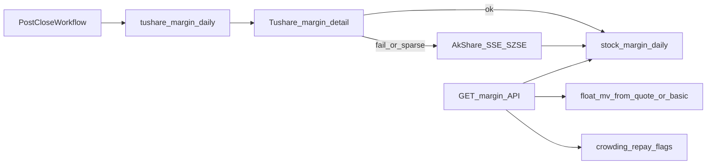

# 两融日度数据采集与踩踏旁证方案

## 前提与边界

- **时效**：交易所约次日 08:30 更新上一日明细；深/北周五数据常下周一才齐。本方案是**日终 T+1 日更**，不是盘中实时强平流。
- **主源**：Tushare `margin_detail`（与现有 [moneyflow.py](backend_core/data_collectors/tushare/moneyflow.py) 同积分档位约 2000；token 复用 `TUSHARE_CONFIG` / `TUSHARE_TOKEN`）。
- **备源**：AkShare `stock_margin_detail_sse` + `stock_margin_detail_szse`，仅在 Tushare 空/失败或深市补采时按日拼沪深。
- **本轮不做**：前端大屏、真正“机构账户爆仓”实锤、与资金流表混写。只做落库 + 查询 API + 可解释旁证字段。

## 数据流

## 1. 表结构 `stock_margin_daily`

对齐 [StockFundFlowEmDaily](backend_api/models.py) 风格：PK `(code, trade_date)`，金额统一**元**，`trade_date` 为 `YYYY-MM-DD`。

建议字段：

- `code`, `trade_date`, `name`（可选）
- `rzye` 融资余额, `rzmre` 融资买入额, `rzche` 融资偿还额
- `rqye` 融券余额, `rqyl` 融券余量, `rqmcl` 融券卖出量, `rqchl` 融券偿还量
- `rzrqye` 两融余额
- 派生可存或查询时算：`rz_net = rzmre - rzche`（融资净买入）
- `source`（`tushare` / `akshare_sse` / `akshare_szse`）, `created_at`, `updated_at`

交付物：

- Alembic 新版本（优先走 `alembic/versions/`）+ ORM 类写入 [backend_api/models.py](backend_api/models.py)
- 幂等 `migrations/add_stock_margin_daily.py`（与仓库习惯兼容）
- Upsert：`ON CONFLICT (code, trade_date) DO UPDATE`（复用 [em_stock_fund_flow_daily.py](backend_core/data_collectors/akshare/em_stock_fund_flow_daily.py) 的 PG upsert 写法）

## 2. 采集器

新建 [backend_core/data_collectors/tushare/margin.py](backend_core/data_collectors/tushare/margin.py)：

- 复用 `moneyflow` 的 token / `code_to_ts_code` / `_trade_date` / `normalize_code` 模式（勿继承硬编码 token 的旧 `TushareCollector`）。
- `collect_margin_for_date(trade_date)`：`pro.margin_detail(trade_date=YYYYMMDD)` 映射后 upsert；注意单次上限约 6000 行。
- `collect_margin_for_code(code, start, end)`：按代码补历史。
- 新建轻量 [backend_core/data_collectors/akshare/margin_detail.py](backend_core/data_collectors/akshare/margin_detail.py)：同日拉 SSE+SZSE，字段对齐后 upsert；`source` 分市场标记。
- 编排策略：`auto` = 先 Tushare；失败或行数异常偏低再 AkShare 补空缺（已有 `tushare` 行不被 akshare 降级覆盖）。

回填：`test/backfill_margin_daily.py`，循环 `list_open_trade_dates`（见 [moneyflow_daily.py](backend_core/data_collectors/tushare/moneyflow_daily.py)）+ sleep，默认回填近 120 个交易日。

## 3. 工作流日采与补洞

- 在 [node_registry.py](backend_core/data_collectors/workflow/node_registry.py) 登记 `tushare_margin_daily`。
- adapter：仿 `exec_tushare_moneyflow_daily`——收盘门禁、解析 trade_date、失败 continue。
- 迁移仿 [add_tushare_moneyflow_workflow_node.py](migrations/add_tushare_moneyflow_workflow_node.py)：挂入「A股收盘后标准流程」，插在 `tushare_moneyflow_daily` 之后。
- **深市滞后**：周一节点内对上周五再跑一次补采；日志标明 `szse_lag_retry`。

建议调度：收盘后流程中资金流节点之后即可；当日未就绪时靠 continue + 次日/周一补采，避免卡死整条流水线。

## 4. 查询与踩踏旁证 API（薄层）

新建 `backend_api/stock/margin.py` 并挂入现有 stock router：

- `GET /api/stock/{code}/margin?start=&end=`：原始两融序列 + `rz_net`。
- `GET /api/stock/{code}/margin/signal?trade_date=`：当日/近 N 日旁证，**查询时计算、不另建信号表**：
  - `crowding = rzye / float_mv`：流通市值优先用行情流通市值或 basic 流通股本 x 收盘价。
  - `rz_net` 连续为负天数、`rzye` 近 5/10 日降幅、相对近 20 日分位。
  - 规则化 flag：`high_crowding`、`accel_repay`、`balance_collapse`；组合输出 `squeeze_risk: low|mid|high`，文案标明旁证非实锤。

本轮不硬绑龙虎榜；后续可在 signal 响应里可选附带同日机构净卖。

## 5. 验收

- 单日写入行数与全市场两融标的量级同阶。
- 同日重跑幂等。
- 周一确认上周五深市标的被补齐。
- API 对高融资股给出 crowding / rz_net / squeeze_risk；缺市值时降级为仅余额序列。
- token 积分不足时返回可读错误，不写半截脏数据。

## 关键文件

- 新增：`backend_core/data_collectors/tushare/margin.py`、`akshare/margin_detail.py`、workflow adapter、Alembic/migration、`backend_api/stock/margin.py`、回填脚本
- 改动：[backend_api/models.py](backend_api/models.py)、[node_registry.py](backend_core/data_collectors/workflow/node_registry.py)、workflow adapters、stock 路由注册
