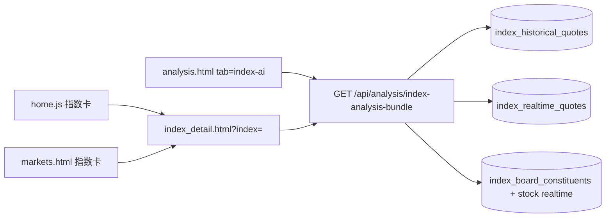

# 指数分析功能（对齐个股分析）

## 已锁定决策（grill 建议采纳）

1. **入口主次**：`index_detail.html` 为单指数主入口；分析 Tab 做完整同构分析工作台（可内嵌同一面板，不强制跳转），四大指数快选；带 `index=` 的深链优先打开详情页（与个股 deep-link 一致）。
2. **综合研判口径**：标题用「市场环境研判」，输出偏多/中性/偏空 + 关键位/结构摘要；**禁止**买卖点、仓位、止损止盈等交易口吻（避免伪信号）。
3. **无成分验收**：技术模块（PA）独立验收；广度/贡献无成分时明确空态即可过关；**验收必测有成分的 `000300`（及库内有成分的指数）**，保证 2Z 真路径可演示。
4. **行业贡献算法**：首期用成分股当日涨跌幅的**成交额加权**聚合到行业板；UI 标注「非官方权重，近似贡献」；同时保留等权涨跌家数/中位数作广度指标。
5. **实时分析**：首期实现——读 `index_realtime_quotes` 叠当日未收盘 bar 后重算 PA；无实时则降级日线并提示。
6. **导出**：首期做轻量 **PNG 长图**（复用个股 PNG 骨架改标题）；PDF 后置。
7. **权限**：新增 `channel.analyze.tab.index`（及 `.btn.analyze`），migration 中**默认授予与 `stock_ai` 相同角色**，避免「有入口无权限」。

## 目标与约束

- **双入口**：行情/首页指数卡 → 指数详情页；智能分析中心「指数分析」Tab 为同能力工作台。
- **双能力**：指数 K 线价格行为 + 指数特有广度/强弱/近似行业贡献。
- **身份隔离**：全程 `index` 语义（URL 用 `index=` / `ts_code`），禁止把 `000001` 丢进个股分析。
- **首期范围**：A 股四大指数（`000001` / `399001` / `399006` / `000300`）；港股后置。
- **不做**：个股四策略、RS、资金流、主力、集合竞价、加自选、交易口吻的进出场建议、首期 PDF。

## 信息架构

## 后端

### 1. 指数日线加载（公共）

新增 [`backend_core/analysis/index_bars.py`](backend_core/analysis/index_bars.py)：

- 复用 [`normalize_index_ts_code`](backend_core/strategies/sbbr/data_loader.py) / [`code_to_ts_code`](backend_core/data_collectors/akshare/cn_index_historical_collector.py)
- `load_index_ohlc_asc(db, code, lookback, asof)` 读 `index_historical_quotes`
- `merge_index_realtime_bar(...)`：用 `index_realtime_quotes` 叠加当日未收盘 bar（`use_realtime=1` 时启用；不走股票实时接口）

### 2. Bundle 编排

新增 [`backend_core/analysis/index_analysis_bundle.py`](backend_core/analysis/index_analysis_bundle.py) + 路由（建议挂在现有 [`board_analysis_routes.py`](backend_api/stock/board_analysis_routes.py) 同前缀，或新文件 `index_analysis_routes.py` 并 `include_router`）：

`GET /api/analysis/index-analysis-bundle?code=000001&date=&use_realtime=`

权限：`channel.analyze.tab.index`（及 `.btn.analyze`）。

返回 `data` 结构（对齐个股 bundle 可渲染字段，缺省模块显式 `null`）：

- `index`：code / ts_code / name / 现价涨跌
- `levels` / `pattern` / `swing` / `gann`：对指数 bars 调用现有引擎（`KeyLevels`、形态、`analyze_market_structure`、江恩）；**不走** `batch_load_ohlc_asc` 个股表
- `market_view`：市场环境研判（bias + 摘要 bullets + 关键位要点；无 trade_plan 式买卖字段）
- `breadth`：成分涨跌家数、涨跌比、中位数涨跌幅；`available: false` 时附 reason
- `leaders`：涨幅/跌幅 Top N（链到 `stock.html?tab=analysis`）
- `sector_contrib`：成交额加权行业贡献 + `disclaimer`；无成分时 `available: false`

成分数据：`index_board_constituents` + 个股实时行情。无成分（如上证可能不全）→ 空态；有成分指数（至少 `000300`）为 2Z 验收主路径。

### 3. 辅助接口

- `GET /api/market/index/{code}` 或复用/扩展现有 `/api/market/indices` 单项详情（详情页抬头）
- `GET /api/market/index/{code}/kline?limit=` 供详情页 ECharts（读指数历史表）

### 4. 权限

在 [`permission_registry_data.py`](backend_api/permission_registry_data.py) 增加：

- `channel.analyze.tab.index`（指数分析）
- `channel.analyze.tab.index.btn.analyze`

并补 migration（参照 [`migrations/add_rs_analysis_tab_permission.py`](migrations/add_rs_analysis_tab_permission.py)）：**复制 `stock_ai` 已有角色授权**到新权限码。

## 前端

### 1. 指数详情页（主入口，对齐个股详情）

新增：

- [`frontend/index_detail.html`](frontend/index_detail.html)
- [`frontend/js/index_detail.js`](frontend/js/index_detail.js)
- [`frontend/css/index_detail.css`](frontend/css/index_detail.css)（尽量复用 `analysis.css` 的 `ssa-*`）

布局：返回行情 → 指数抬头（价/涨跌）→ K 线 → 分析面板挂载点。

URL：`index_detail.html?index=000001`（可选 `&popup=1`）。

分析面板：[`frontend/js/index_analysis_panel.js`](frontend/js/index_analysis_panel.js) + [`frontend/js/index_analysis.js`](frontend/js/index_analysis.js)

- 复用个股面板区块样式与 PA 渲染思路，但独立编排，避免改坏 `StockMultiStrategy`
- 区块顺序：市场环境研判 → 广度/强弱/行业贡献（近似）→ 价格行为（波段→形态→关位）→ 江恩
- 导出：首期 **PNG 长图**；PDF 不做

### 2. 分析频道 Tab

改 [`frontend/analysis.html`](frontend/analysis.html) / [`frontend/js/analysis.js`](frontend/js/analysis.js)：

- 新 Tab：`data-tab="index-ai"`「指数分析」
- 工具栏：四大指数快选 + 代码输入 + 基准日 + 分析 / 实时分析；结果区复用同一 `IndexAnalysisPanel`（不做成残缺版）
- 深链：`analysis.html?tab=index-ai&index=000001` → 重定向到 `index_detail.html?index=...`（工作台无参时留在 Tab）

### 3. 行情入口打通

- [`frontend/js/markets.js`](frontend/js/markets.js)：A 股 `.index-card` 点击 → `index_detail.html?index=`；消费已有 `?index=` 直接跳转详情（修首页悬空深链）
- [`frontend/js/home.js`](frontend/js/home.js)：指数卡改为直达 `index_detail.html?index=`（比停在 markets 更符合 1C）

## 测试（放 [`test/`](test/)）

- `test_index_analysis_bundle.py`：ts_code 映射、`000001` 不碰 `historical_quotes`、无成分 breadth 空态、`000300`（或 fixture 成分）涨跌计数与成交额加权贡献、`market_view` 无买卖字段
- 权限 migration 冒烟（可选）

## 明确不做 / 后置

- 港股指数详情
- PDF 导出、官方指数权重、交易口吻进出场
- `board-signals` 的 `board_kind=index` 全量策略扫描（选股 `scope=index_board` 已存在）
- 修改个股 `stock-analysis-bundle` 兼容指数
